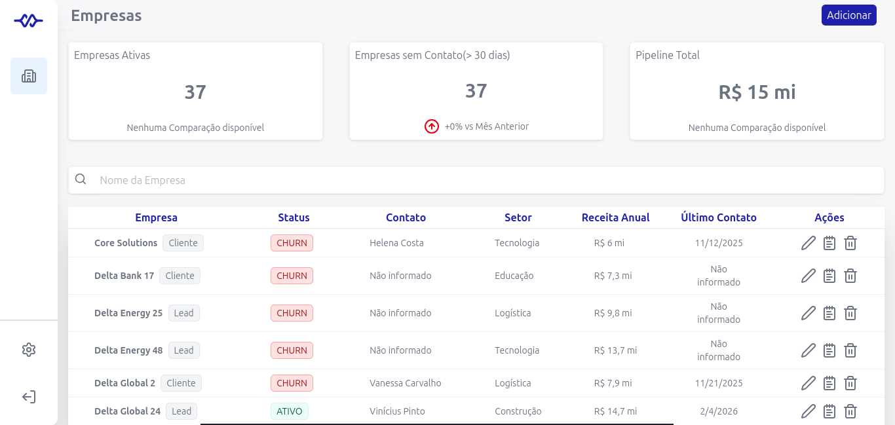
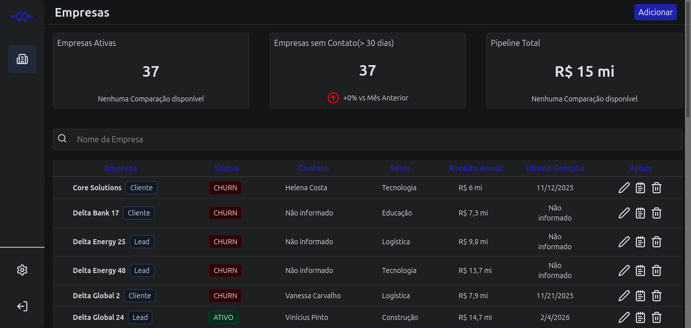
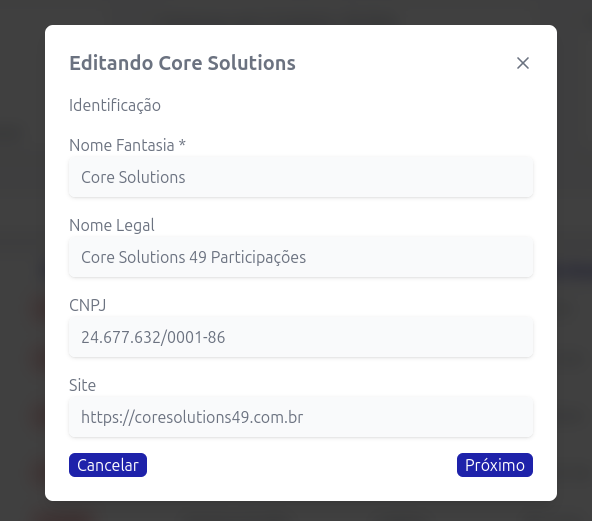

# Nexapulse

CRM web multitenant com autenticação, gestão de empresas e isolamento de dados por organização via Row Level Security.

> **Versão 2.0**, reconstruída do zero a partir do [NexaFlow](https://github.com/guilhermegodoydev/crm-arquivado) (V1, arquivada).

[🔗 Acesse o Nexapulse](https://nexapulse.netlify.app/)

## Conta de demonstração

Para testar o gerenciamento e as políticas de segurança (RLS):

- **E-mail:** `fabio@nexus.com`
- **Senha:** `fgomes123`

## Screenshots

  
  
  
  

## Por que reconstruir? (V1 vs V2)

A V1 funcionava, mas travava o desenvolvimento. Reconstruí do zero por três motivos:

| Problema | Na V1 | Na V2 |
|---|---|---|
| **Arquitetura** | Estrutura de pastas clássica, com acoplamento excessivo e dependências circulares. Debugar era lento. | **Feature-Sliced Design:** cada funcionalidade é independente, fácil de achar e de evoluir sem efeito colateral. |
| **Estado e persistência** | Simulador de servidor no `localStorage`, com bugs de sincronização e estados inconsistentes. | **Supabase + TanStack Query:** cache, estados de erro e persistência ficam com ferramentas feitas para isso, sem código manual. |
| **Escopo** | Features demais sem propósito claro, muitas incompletas. | **MVP definido:** cada feature tem um motivo de negócio, e o foco é entregar algo polido e pronto para produção. |

## Arquitetura: Feature-Sliced Design

Organização em camadas para separar responsabilidades:

- **App:** configurações globais, providers e roteamento.
- **Pages:** composição das telas.
- **Widgets:** blocos que combinam várias funcionalidades.
- **Entities:** lógica de negócio e schemas (User, Company).
- **Shared:** UI reutilizável, hooks genéricos e instâncias de API.

## Stack

| Tecnologia | Papel no projeto |
|---|---|
| React + Vite | Interface e ambiente de desenvolvimento/build |
| Supabase (PostgreSQL) | Persistência real e Row Level Security (segurança no nível do banco) |
| TanStack Query | Cache e sincronização de estado servidor-cliente |
| Zod | Validação de dados e tipos em runtime |
| React Router | Navegação com loaders e `HydrateFallback` |
| Tailwind CSS | Estilização responsiva |

## Funcionalidades

- **Autenticação:** login e proteção de rotas.
- **Gestão de empresas (CRUD):** fluxo completo com validações.
- **Busca otimizada:** filtros com debounce para reduzir requisições.
- **Segurança multitenant:** cada usuário só acessa os dados da própria organização, garantido por RLS.
- **UX:** skeletons e splash screen durante o carregamento.
